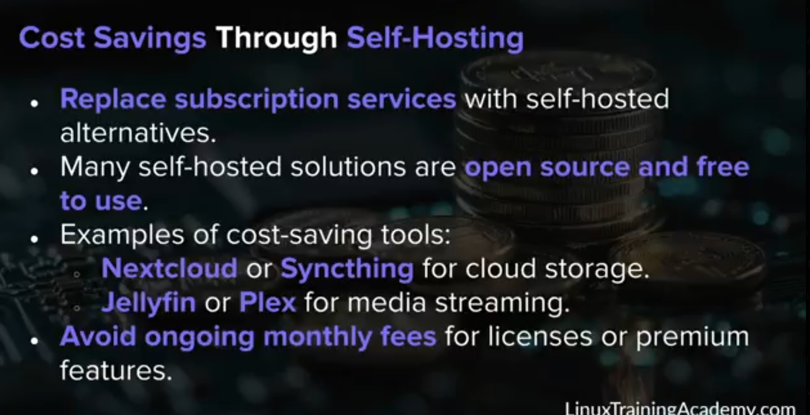
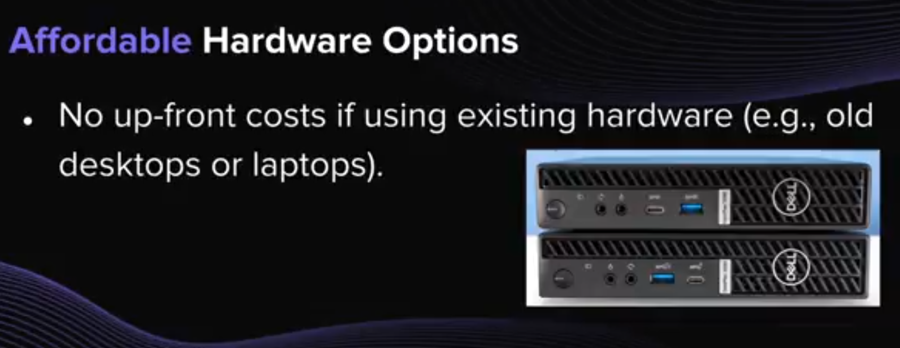
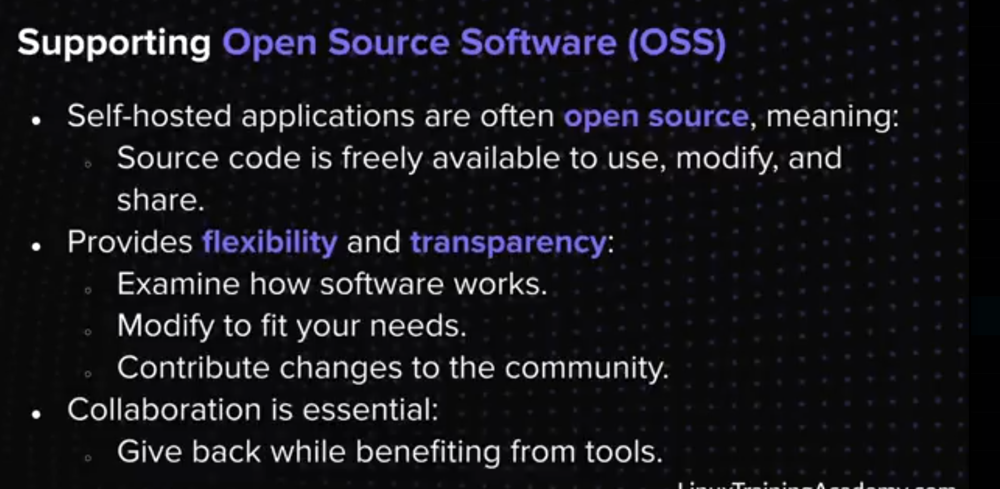
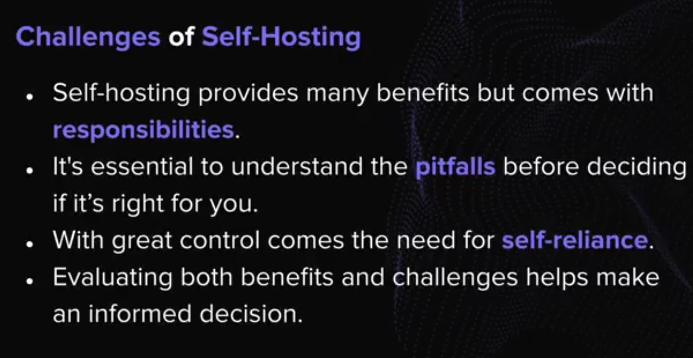
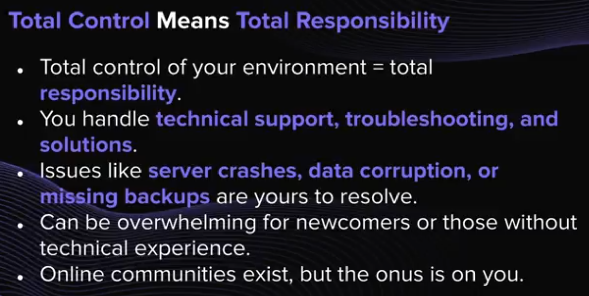
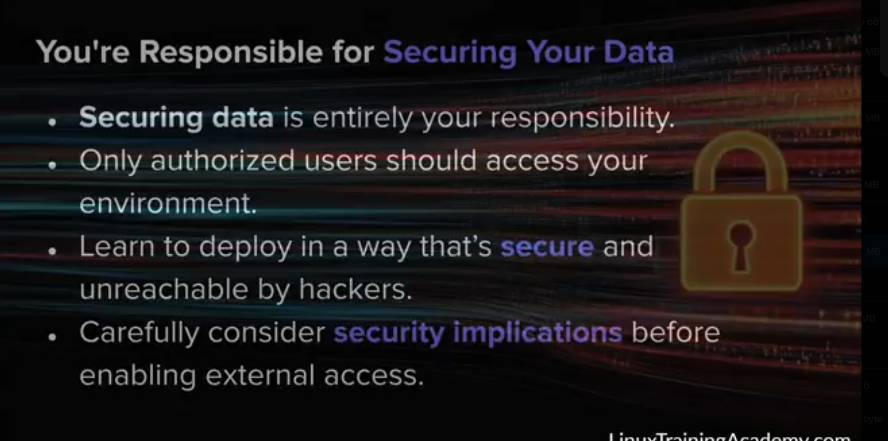
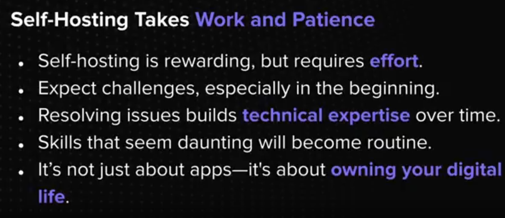
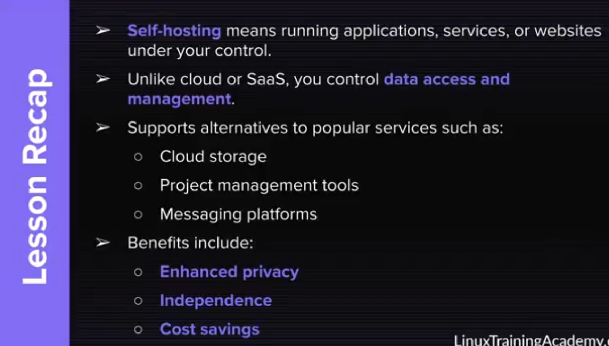
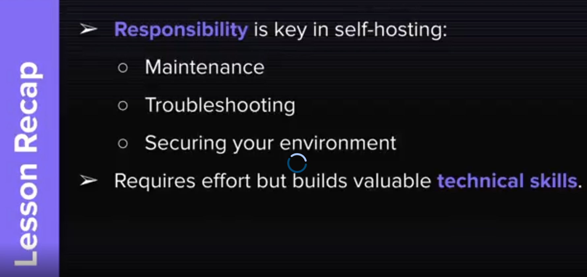

## Benefits of self-hosting

## What is a virtual private server (VPS)?
- A VPS is a virtualized server hosted in a data center managed by a provider.
- Eliminates the need for owning or managing physical hardware.

## 04. Gain valuable skills through self-hosting
- Gain valuable skills in **server configuration**.
- Learn to manage **software configuration** and troubleshoot issues.
- Develop expertise in system optimization and performance tuning.
- Build knowledge in **networking, security, and resource management**.
- Enhance your technical profile, especially for IT careers.
- Encourage **problem-solving** and critical thinking.
- Adapts tools to fit specific needs and requirements.
- Challenges sharpen **logical and creative thinking**.
- Expands technical knowledge with every new project or application.
- Develops innovative solutions for unique problems.

### Hardware Failure
- Hardware issues can cause downtime or interruptions.
- Home-hosting risks include power outages and non-auto-strating devices.
- Internet outages also mean your servers are unreachable.
- Cloud providers yse redundancy to minimize interruptions.
- Home setups generally lack advanced failover solutions.

### Summary of self-hosting

