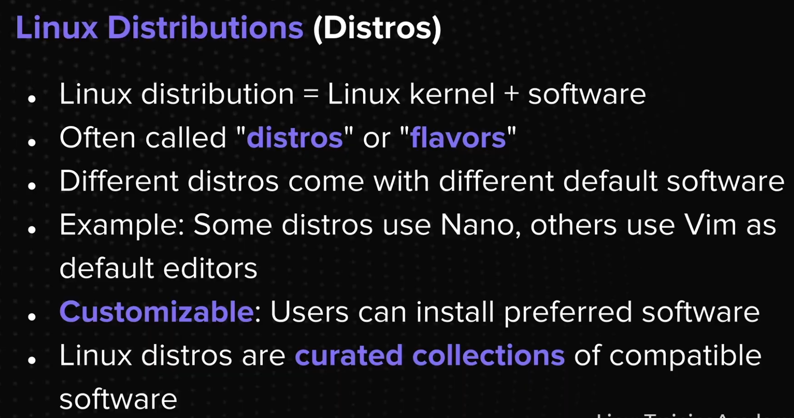
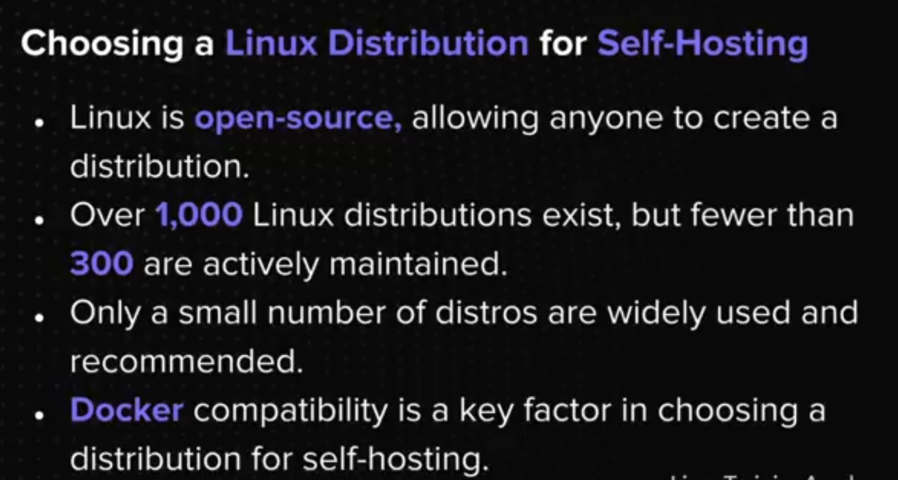
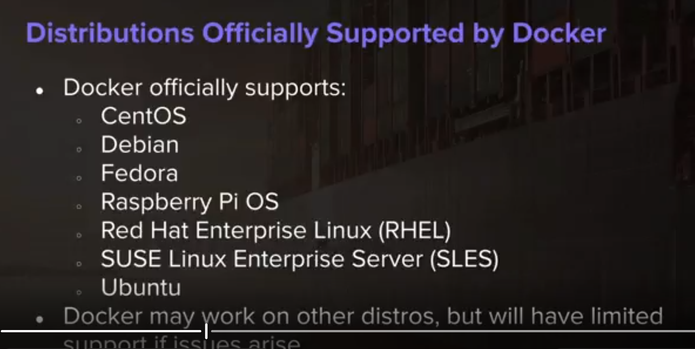
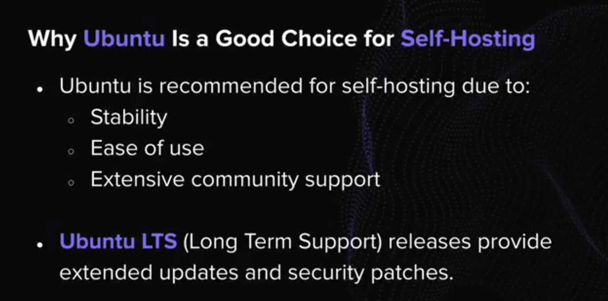
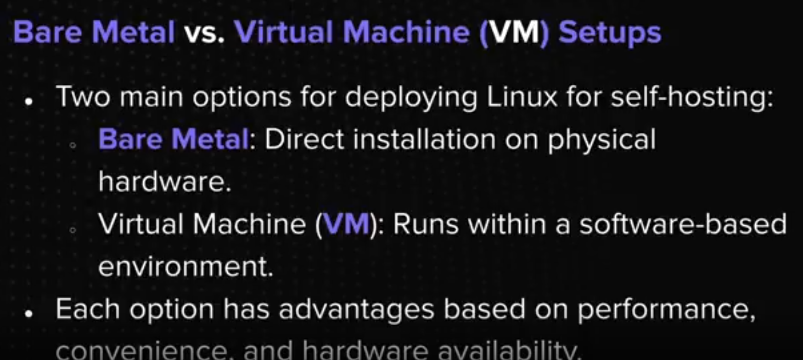
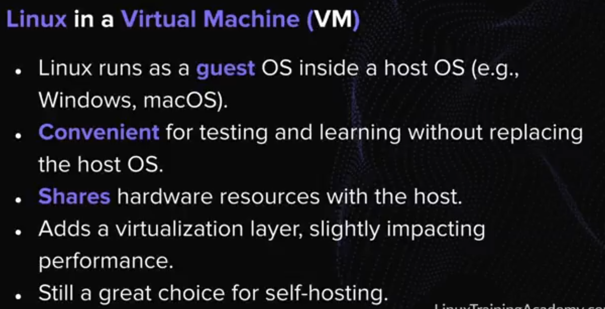

## 1. What linux is
## 2. Why linux 
## 3. Why Ubuntu LTS (is an ideal choice for self-hosting)

## 1. What is Linux?
- Linux is technically a kernel.
- A kernel is the core of an OS that interacts with hardware.
- It sits between hardware and applications.
- Acts as an interface for applications to use hardware (e.g., processors, memory).

- Linux often refers to a Linux distribution.
- A Linux distribution = Linux kernel + software.
- Operating System (OS): manages hardware and application execution.
- Enables storage, display and networking capabilities.
- Examples of OS: Windows & macOS.

## 2. Why linux
- Linux is an open-source and free to use.
- No licensing fees, making it cost-effective.
- Ideal for self-hosting environments that aim to reduce costs.

# B. Choosing a Linux Distribution for Self-Hosting

## Windows Subsystem for Linux (WSL) Support
- Ubuntu is the default Linux distribution for WSL.
- Easily install and run Ubuntu on Windows.
- Best of both worlds: Use Windows while benefiting from Ubuntu.

## Linux on Bare Metal
- Installed directly onto physical hardware.
- Best performance - full access to CPU, memory, and storage.
- No virtualization overhead = faster and more efficient.
- More stable and reliable with fewer moving parts.

## Linux in a Virtual Machine (VM)
- Linux runs as a guest OS inside a host OS (e.g., Windows or macOS).
