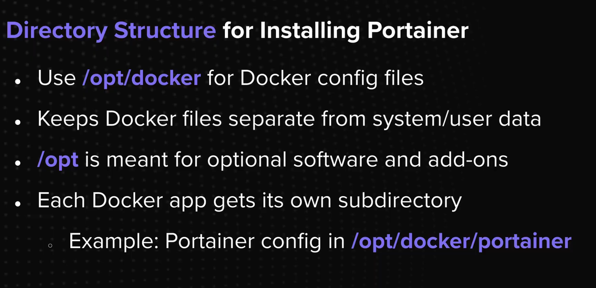

# Docker and Portainer
## 01 - Installing Docker on the Ubuntu Linux Docker Host
## 02 - Introduction Portainer
## 04- Docker compose and Docker run and YAML Configuration

# Summary
- Portainer is a popular tool for managing Docker environments.
- How to deploy, configure and access Portainer on your Tailscale network.