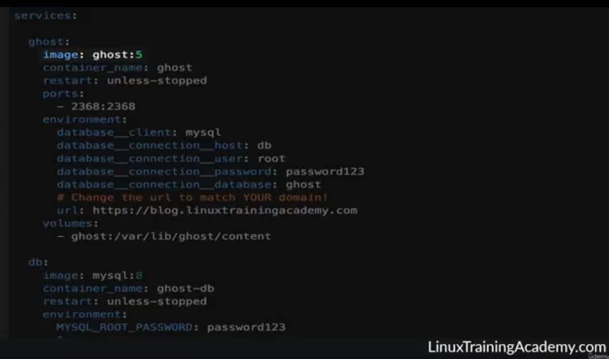
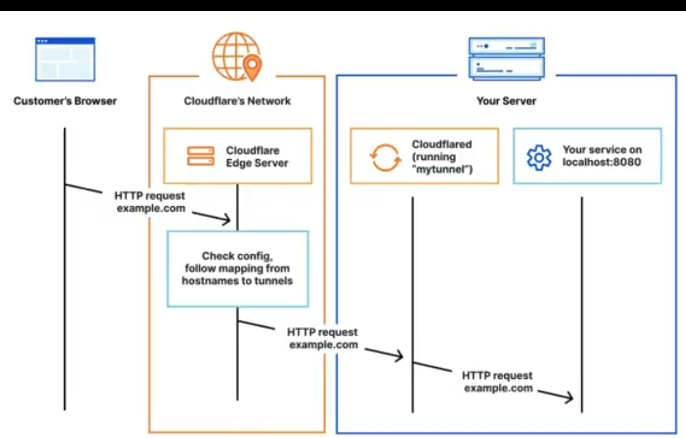
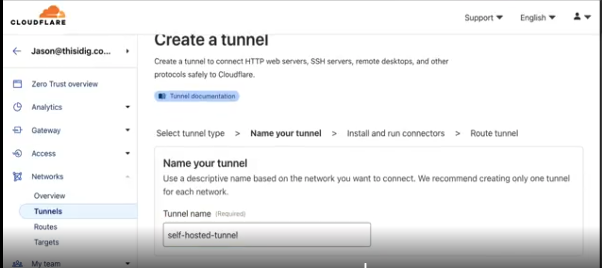
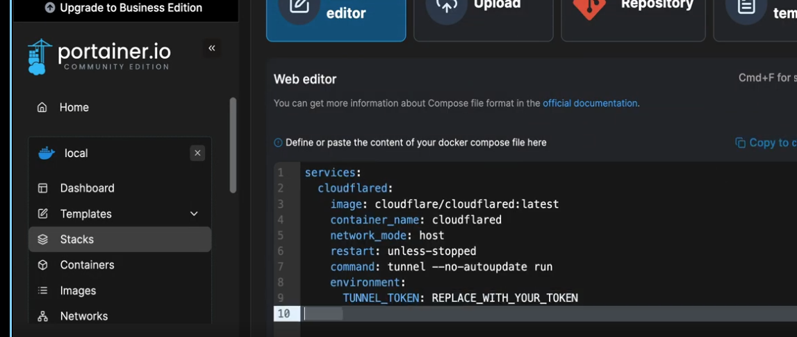
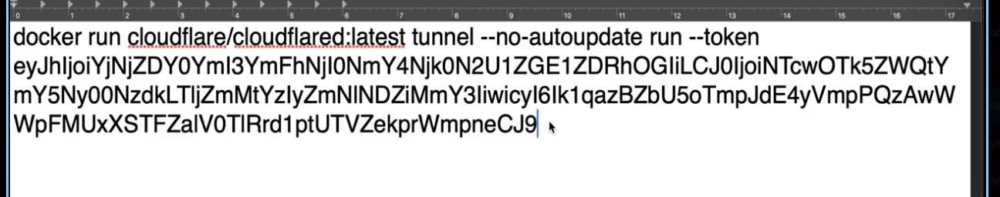
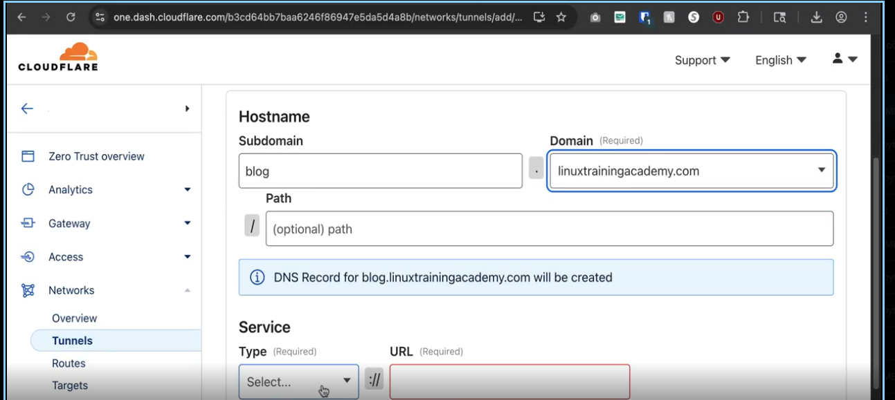
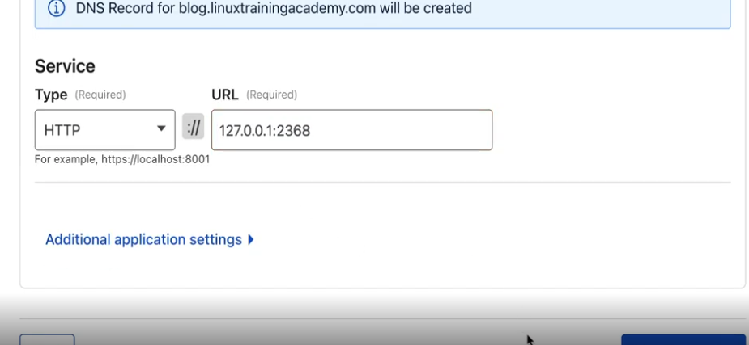
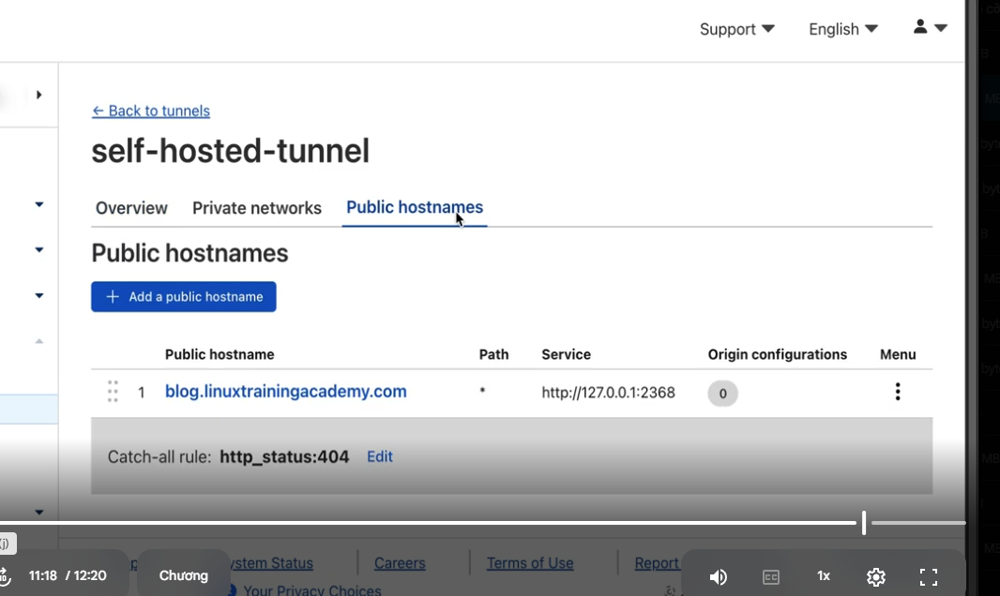

# using own domain with setting up caddy.
# And then, make self-hosted services publicly available.
- Previously, services were limited to tailnet devices for privacy.
- Now, you'll learn to expose services to the public internet.
- Example: Deploy Ghost blog and publish it using your own domain via Cloudflare Tunnels.
1. Add stack that names ghost

2. 

3. Create cloudflare tunnels

4. Creat cloudflare on docker

5.

6. Click to deploy agian wit hothers 
